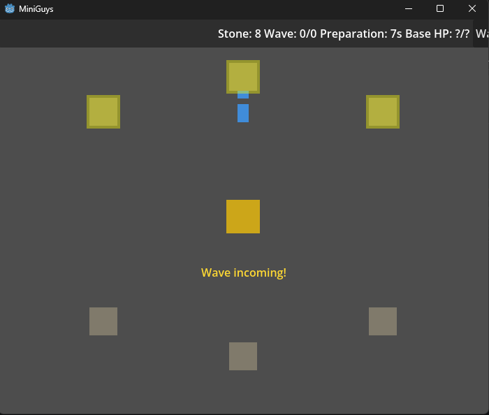

# Autonomous Worker Base Defence MVP

> [!WARNING]
> **AI-authored:** This change was autonomously planned and implemented by an AI software factory from a human-authored specification, with possible subsequent human review or modification.

> [!WARNING]
> This experiment is effectively abandoned. The generated material is retained primarily as a research artifact.

A _very poor quality_ 2D Godot game where the player guides autonomous workers who gather stone, build walls and towers, and defend a central base against waves of enemies.

- [VISION.md](VISION.md) — full game design, MVP scope, and component descriptions
- [DESIGN.md](DESIGN.md) — Godot-native architecture: scenes, signals, autoloads, and implementation phases
- [CODEMAP.md](CODEMAP.md) — repository structure, technology stack, build commands, and conventions

## Notes

- another strong example of what the Factory model emphasizes
- heavily optimized for routine operations
- effective within that space; behaviour makes sense given its origins
- original design inspiration; codemods / code transformation
- especially suited to micro-changes with limited ambiguity
- examples; dependency upgrades, backwards-compatibility fixes, continuous refactoring
- also capable of prototypes and incremental product work
- examples; new frontend pages, backend routes
- likely because these are still fundamentally routine operations
- weakness becomes obvious when work gets more creative, exploratory, or conceptually novel
- does not handle those cases nearly as well
- not necessarily a model-quality problem
- more likely a consequence of the Factory structure, assumptions, and operating context
